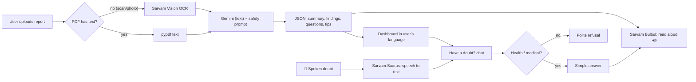

# Samjho: Medical Report Explainer

> **समझो** (*samjho*) means "understand".

Upload a medical report and Samjho explains it **in your own language, in simple words**. It works for
anyone with no medical background. You can then ask follow-up doubts about your report or your health.

Built for the Sarvam AI hackathon. It supports **11 Indian languages**.

- **Text explanation:** Gemini (or Sarvam `sarvam-105b`, or any provider you plug in).
- **Voice:** always **Sarvam**. Bulbul reads the explanation aloud, and Saaras understands spoken questions.
- **Reading scanned reports:** Sarvam Vision.

> ⚠️ Samjho is for understanding only. It is **not medical advice** and never diagnoses or prescribes.

---

## What it does

| Feature | How |
|---|---|
| 📄 **Submit a report** | Drag-and-drop a PDF / JPG / PNG (≤ 4 MB), paste the text, or try the built-in sample |
| 🔍 **Read scans and photos** | Digital PDFs are read instantly with `pypdf`. Scans and phone photos go through **Sarvam Vision** (Document AI OCR) |
| 🗣️ **Explain in your language** | Hindi, English, Bengali, Tamil, Telugu, Kannada, Malayalam, Marathi, Gujarati, Punjabi, Odia |
| 🔊 **Listen** | The explanation is read aloud in your language by **Sarvam Bulbul** (auto-play toggle, 8 voices) |
| 🎤 **Ask by voice** | Speak your doubt in any Indian language. **Sarvam Saaras** transcribes it and detects the language, and the answer comes back in that language, spoken |
| 🚦 **Clear verdict** | An overall badge (normal / needs attention / see a doctor soon), plus one card per test with value, normal range, ↑/↓ status and what it means |
| 💬 **Have a doubt?** | Chat that answers **health and medical questions only**, using your report as context |
| 🔑 **Bring your own AI** | Use Sarvam (built in) or paste your own key for OpenAI, Claude, Gemini, OpenRouter, or any OpenAI-compatible API |
| 🧩 **MCP server** | The same explainer as tools for AI agents (Claude Desktop, Claude Code, …), also medical-only |

---

## How it works



**Who does what**

| Step | Service | Endpoint |
|---|---|---|
| Read scanned report / photo | Sarvam Vision (`doc_ai.digitise`) | `/api/extract` |
| Write the explanation and answers (text) | **Gemini** if `GEMINI_API_KEY` is set, else Sarvam `sarvam-105b` (switchable in the UI) | `/api/explain`, `/api/ask` |
| Read text aloud | **Sarvam Bulbul** `bulbul:v3` | `/api/tts` |
| Understand spoken questions | **Sarvam Saaras** `saaras:v3` (auto language detection) | `/api/stt` |

1. **Extract** (`POST /api/extract`): text PDFs are parsed locally. If a PDF has under 80 characters of text,
   or the upload is an image, it is sent to Sarvam Vision (`doc_ai.digitise`) and polled until done (max 60 s).
2. **Explain** (`POST /api/explain`): the report goes to the chosen model with a strict system prompt. It
   asks for plain words, compares values with the printed ranges, flags anything urgent, never diagnoses or
   prescribes, and replies in the chosen language. The model returns JSON, which the dashboard renders as
   cards. If the document isn't medical, it returns `not_medical: true`.
3. **Ask** (`POST /api/ask`): follow-up questions with the report and the last few turns as context.
   Non-medical questions are refused (see [Medical-only guardrails](#medical-only-guardrails)).

4. **Listen** (`POST /api/tts`): the browser splits the text into ~900-character pieces at sentence ends.
   It fetches the first piece's audio from Bulbul and starts playing, while the next piece loads in the background.
   It reads the summary plus what each abnormal value means. Chat answers can be played too.
5. **Speak** (`POST /api/stt`): the mic records up to 30 s (webm/opus), and Saaras returns the transcript and
   the detected language. The app switches to that language, so the answer is written and spoken in it.

Reports are **never stored**. They live only in the request and in your browser tab.

---

## Tech stack

| Layer | Choice |
|---|---|
| Backend | Python 3.12 · FastAPI · Uvicorn |
| AI | `sarvamai` SDK: Sarvam Vision (OCR), `sarvam-105b` and other Sarvam-hosted chat models |
| Other providers | Plain HTTPS via `httpx`: OpenAI-compatible `/chat/completions` and Anthropic `/messages` |
| Frontend | One static file: `public/index.html` (HTML + CSS + vanilla JS, no build step) |
| MCP | Official `mcp` Python SDK v2 (`MCPServer`, stdio transport) |
| Hosting | Vercel Python runtime (`api/index.py`) + static `public/` |

## Project structure

```
api/index.py        FastAPI app: /api/* routes; also serves public/ locally (Vercel entrypoint)
core/sarvam.py      Sarvam client, model list, PDF/OCR text extraction
core/llm.py         Provider routing: Sarvam, OpenAI-compatible, Anthropic (bring your own key)
core/explainer.py   explain() and ask() with the medical-only guardrails (shared by web + MCP)
core/prompts.py     System prompts, languages, sample report
public/index.html   The whole dashboard
mcp_server.py       MCP server exposing the explainer as tools
vercel.json         Function timeout (Vercel auto-detects the FastAPI app)
```

---

## Run locally (Windows)

**Prerequisites:** Python 3.12 (`py -3.12`) and a Sarvam API key from the [Sarvam dashboard](https://dashboard.sarvam.ai).

```powershell
cd Sarvam_Medical_Report_Explainer

# one-time setup
py -3.12 -m venv .venv
.\.venv\Scripts\Activate.ps1          # cmd: .venv\Scripts\activate.bat
pip install -r requirements.txt

# add your keys: copy the template and fill it in (see "API keys" below)
copy .env.example .env

# run
uvicorn api.index:app --reload --port 8000
```

Open **http://localhost:8000**. Every new terminal needs the `Activate` step again.
After changing `.env`, restart the server (Ctrl+C, then run it again).

On macOS/Linux use `python3 -m venv .venv` and `source .venv/bin/activate`.

### API keys (`.env`)

```ini
SARVAM_API_KEY=sk_...      # required: voice (Bulbul + Saaras), scanned reports (Vision), Sarvam text models
GEMINI_API_KEY=AIza...     # recommended: Gemini writes the text explanations
# GEMINI_MODEL=gemini-3.8-flash   # optional override
# TEXT_PROVIDER=gemini            # optional: force the default text provider (sarvam | gemini | openai | ...)
# SARVAM_TTS_VOICE=ritu           # optional default voice
```

- Get a Gemini key at https://aistudio.google.com/apikey and a Sarvam key at https://dashboard.sarvam.ai.
- **How the app chooses the text provider:** if `GEMINI_API_KEY` is set, Gemini is the default; otherwise Sarvam.
  The provider button in the top bar shows what is active (e.g. "Google Gemini · gemini-3.8-flash"), and users can
  still switch to Sarvam or paste their own key. Server keys are never sent to the browser. The UI only learns
  *that* a key exists.
- **Voice always uses Sarvam**, whichever provider wrote the text.
- Restart the server after editing `.env`.

---

## Bring your own AI provider

Click the **provider button** (top-right, shows "Sarvam AI") to switch provider:

| Provider | Default model | Notes |
|---|---|---|
| Sarvam AI | `sarvam-105b` | Built in, uses the server's key. Pick other Sarvam models in the **Model** dropdown |
| OpenAI | `gpt-4o-mini` | |
| Anthropic Claude | `claude-haiku-5-5` | |
| Google Gemini | `gemini-3.8-flash` | Via Gemini's OpenAI-compatible endpoint |
| OpenRouter | `openai/gpt-4o-mini` | Any OpenRouter model id |
| Other | — | Any OpenAI-compatible API (`https://…/v1`) |

Model names change often, so the model field is editable. Use **Test connection** before saving.

**Key handling:** the key is sent only with your own requests, used for that one call, and never logged or
stored on the server. "Remember on this device" keeps it in your browser's `localStorage`. Leave it
unticked to keep the key only until you close the tab. Custom base URLs must be public `https://`
addresses (requests to private or local networks are blocked).

The same medical-only rules apply to every provider, because the guardrails live in our prompt and backend, not in the provider.

---

## Medical-only guardrails

Samjho stays on topic. These rules apply to the web app and the MCP server:

- **Doubts chat and `ask_medical_question`:** the system prompt only allows health topics (the body,
  symptoms, lab tests, medicines in general terms, health-related diet and exercise, which doctor to
  see). For anything else, the model must reply with an `[OFF_TOPIC]` tag. The backend detects the tag
  and returns `off_topic: true` with a polite refusal in the user's language. Refusals are kept out of the
  chat history, so they can't be used to steer later answers.
- **Explain and `explain_medical_report`:** a document that isn't medical returns `not_medical: true`.
- **Prompt-injection hardening:** report text is treated as data, and the prompt tells the model to
  ignore instructions inside the report or attempts to "ignore the rules".
- **Safety:** no diagnosis, no prescribing or dose changes. Emergency signs lead to "call 112 / 108".
  Answers never invent values that are not in the report.

---

## MCP server

`mcp_server.py` exposes the explainer to any MCP client over stdio.

| Tool | What it does |
|---|---|
| `explain_medical_report(report_text, language="en-IN")` | Full structured explanation (or `not_medical: true`) |
| `ask_medical_question(question, language="en-IN", report_text="")` | Answers health doubts; non-medical questions give `off_topic: true` |
| `extract_report_text(file_path)` | Reads a local PDF/JPG/PNG/WEBP (≤ 4 MB), using Sarvam Vision for scans |
| `list_languages()` | Supported language codes |

**Add to Claude Code:**
```powershell
claude mcp add samjho -- "C:\path\to\Sarvam_Medical_Report_Explainer\.venv\Scripts\python.exe" "C:\path\to\Sarvam_Medical_Report_Explainer\mcp_server.py"
```

**Add to Claude Desktop** (`claude_desktop_config.json`):
```json
{
  "mcpServers": {
    "samjho": {
      "command": "C:\\path\\to\\Sarvam_Medical_Report_Explainer\\.venv\\Scripts\\python.exe",
      "args": ["C:\\path\\to\\Sarvam_Medical_Report_Explainer\\mcp_server.py"]
    }
  }
}
```

The MCP server uses Sarvam by default. To use another provider, add to `.env`:
```
LLM_PROVIDER=anthropic          # openai | anthropic | gemini | openrouter | custom
LLM_API_KEY=your_key
LLM_MODEL=claude-haiku-5-5      # optional, defaults per provider
LLM_BASE_URL=                   # only for custom
```

---

## API reference

| Method | Path | Body | Returns |
|---|---|---|---|
| GET | `/api/config` | — | languages, Sarvam models (live), provider presets, sample report |
| POST | `/api/extract` | multipart `file` **or** form `text` | `{text, source: pdf-text \| sarvam-vision \| pasted}` |
| POST | `/api/explain` | `{report_text, language, model, provider?}` | `{result, raw, not_medical, model, provider, ms}` |
| POST | `/api/ask` | `{question, language, report_text?, history?, model, provider?}` | `{answer, off_topic, model, provider, ms}` |
| POST | `/api/tts` | `{text, language, voice?}` (≤ 2500 chars) | `{audios: [base64 WAV, …]}` |
| POST | `/api/stt` | multipart `audio` (≤ 30 s) | `{transcript, language}` |
| POST | `/api/test-provider` | `{provider: {provider, api_key, model, base_url}}` | `{ok, model, ms}` |

`provider` is optional: leave it out to use the server default (Gemini if `GEMINI_API_KEY` is set, else Sarvam).
An empty `api_key` means "use the server's key for that provider".

---

## Deploy to Vercel

1. Push this repo to GitHub.
2. In Vercel: **Add New → Project → import the repo** (no build settings needed).
3. Add the environment variables `SARVAM_API_KEY` and `GEMINI_API_KEY`.
4. Deploy. Vercel detects the FastAPI app in `api/index.py` and sends every path to it; `public/` is served as the site.

Limits: Vercel request bodies are capped at 4.5 MB (the app enforces 4 MB), and functions here time out at
60 s. The MCP server runs locally over stdio and is not part of the Vercel deployment.

---

## Roadmap

- ⚖️ Compare two models side by side
- 🔁 Streaming voice (Bulbul streaming) for even faster first audio
- 🌐 Hosted MCP over streamable HTTP

## Troubleshooting

| Problem | Fix |
|---|---|
| "Sarvam rejected the API key" | Fix `SARVAM_API_KEY` in `.env` and restart the server. The old name `SARVAM_API` also works |
| `uvicorn` not recognized | Activate the venv first |
| `python` is 3.6 | Use `py -3.12` / the venv's Python. The system default is too old |
| PowerShell blocks `Activate.ps1` | `Set-ExecutionPolicy -Scope CurrentUser RemoteSigned` |
| Port 8000 busy | `--port 8001` |
| Model dropdown shows a short fallback list | The live Sarvam model list couldn't be fetched. The app still works |
| "Google Gemini rejected the API key" | Fix `GEMINI_API_KEY` in `.env`, restart |
| "Couldn't find the model" with Gemini | Set `GEMINI_MODEL` to a current model id |
| No sound | Click 🔊 Listen once (browsers block audio until you interact). Check "Read aloud automatically" |
| 🎤 does nothing / permission error | Allow the microphone in the address bar. Mic needs `localhost` or `https` |
